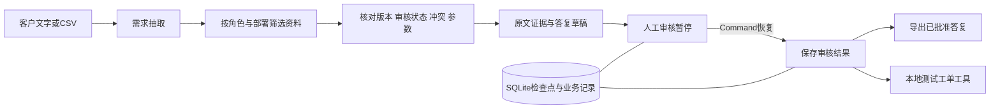

# 架构与限制

## 数据流

离线模式：LangChain RunnableLambda 按已知能力别名抽取；BaseRetriever 从授权资料中筛选同能力、同部署的来源并按字符词项排序；业务规则核对证据。资料中的 capability/stance 是模拟产品负责人整理的标签，不是模型从原文自动得出的事实。

真实模式：LangChain `init_chat_model(..., model_provider="openai")` 与结构化输出接口抽取完整原文要求，随后进入相同的证据规则。答复是受约束模板，不是开放式模型撰写。保留 Token 元数据；没有配置密钥时明确失败。

LangGraph verify→human_review→finalize；human_review 使用 interrupt，跨请求保存 SQLite 检查点。审核通过 service 参数验证后以 Command(resume=...) 恢复。工具调用发生于已经批准的能力缺口，StructuredTool 包装本地 SQLite 工单事务。

## 持久化与重复执行

任务使用客户、需求、角色、部署、版本、模式和资料哈希建立唯一指纹。相同输入返回已有任务，避免页面重复提交重新分析。工单有 task_id/item_id 唯一约束。每次提交、核验、失败、审核和工单创建保存事件。

检查点和业务数据库分别保存；正常重启前后的人工暂停/恢复已测试。审核/恢复/重试使用退出后释放的OS文件锁，失去占用后依据检查点恢复待审核或继续已提交的完成步骤。审核占用后中断已通过异常注入测试。跨库写入不是分布式事务；尚无真实强杀的完整矩阵、生产多进程负载或高可用验证。

## 角色与部署

工作台仅监听 127.0.0.1，适合本地作品展示。销售只能访问销售资料及销售创建的任务；审核负责人可以访问内部资料。身份可以在侧边切换，因此这不是企业认证，不能开放到公共网络宣称安全多租户服务。

## 当前限制

- 别名和限定词规则是有限集合，无法证明任意表达的语义理解；模型抽取也尚未联网验收。
- 文档按人工整理的单能力元数据组织，未实现任意 PDF/OCR 的自动知识治理。
- 未接入语义 Embedding 或向量数据库；默认检索不是向量 RAG。
- 未实现模型自主选择工具、自动对外发送消息或自动承诺交付。
- 当前只允许批准原核验文字。人工改写须退回补充；未实现改写语义的自动事实核验。
- 合成开发案例不等于独立测试集、真实用户准确率或商业效果。

框架参考：
- https://docs.langchain.com/oss/python/langchain/models
- https://docs.langchain.com/oss/python/langchain/tools
- https://docs.langchain.com/oss/python/langgraph/interrupts
